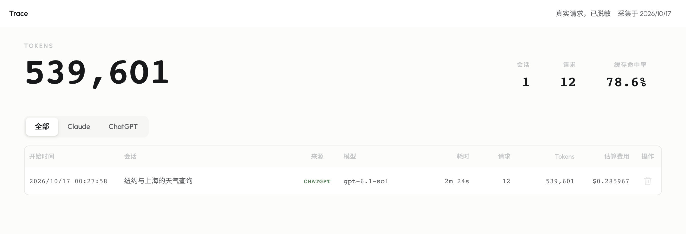

  

<h1 align="center">XwX Deck</h1>

<strong>好工具，更简单</strong>

管理 AI 客户端的模型连接，看清每一次请求。

  <a href="https://xwxdeck.com/#download">下载</a>&nbsp;&nbsp;&nbsp;
  <a href="https://xwxdeck.com/?demo=dashboard#experience">在线体验</a>&nbsp;&nbsp;&nbsp;
  <a href="https://xwxdeck.com/docs/">使用文档</a>

支持 Windows x64 安装版、便携版和 Apple Silicon Mac。

## 一个地方，管理连接与请求

XwX Deck 配合已有 AI 客户端使用。配置模型连接，按需开启 Trace，在本机查看请求的完整过程。

| 能力 | 你可以做什么 |
| --- | --- |
| 模型连接 | 为已接入的 AI 客户端选择服务与模型，保留每个连接的选择。 |
| 请求追踪 | 查看请求、响应、工具调用、Token、参考费用与耗时。 |
| 本地管理 | 管理保存在本机的设置与记录，自行选择存储容量和清理方式。 |

## 下载

从顶部下载入口获取 Windows x64 安装版、便携版或 Apple Silicon Mac 版本。官网同时提供文件校验与安装说明。自动更新清单独立维护。

安装包通过官网和 Cloudflare 分发，GitHub 维护公开源码。安装与更新步骤统一收录于使用文档。

## 三步开始

1. **安装客户端。** 安装 XwX Deck，以及你要使用的 AI 客户端。
2. **添加连接。** 在设置中添加自己的模型服务，或导入已有配置。
3. **选择并使用。** 选择服务与模型，在客户端发起对话；按需开启 Trace，查看仪表盘。

快速开始以 Codex 为例。更多客户端可在“客户端管理”中添加，接入方式以界面提示为准。

新安装的服务列表为空。导入保留来源文件，不会自动切换服务。

## 帮助与反馈

使用文档覆盖连接配置、客户端接入、Trace、账号管理和本地数据维护。
遇到问题可 [提交 Issue](https://github.com/Damue042/XwX_Deck/issues)。
安全漏洞请使用 [私密报告渠道](.github/SECURITY.md)。

## 开发与贡献

后端采用 Rust/Tauri，前端采用 React 和 TypeScript。

- [开发说明](docs/development.md)：环境、运行与验证入口。
- [贡献指南](.github/CONTRIBUTING.md)：问题反馈与代码贡献。

## 许可与数据

项目采用 [Apache License 2.0](LICENSE)。第三方组件与资产见 [许可说明](docs/licenses/third-party-notices.md)。

设置、Trace 与日志保存在本机。模型请求发送至所选服务，参考费用需与服务商实际账单分别核对。在线演示使用脱敏请求记录和示例配置。
